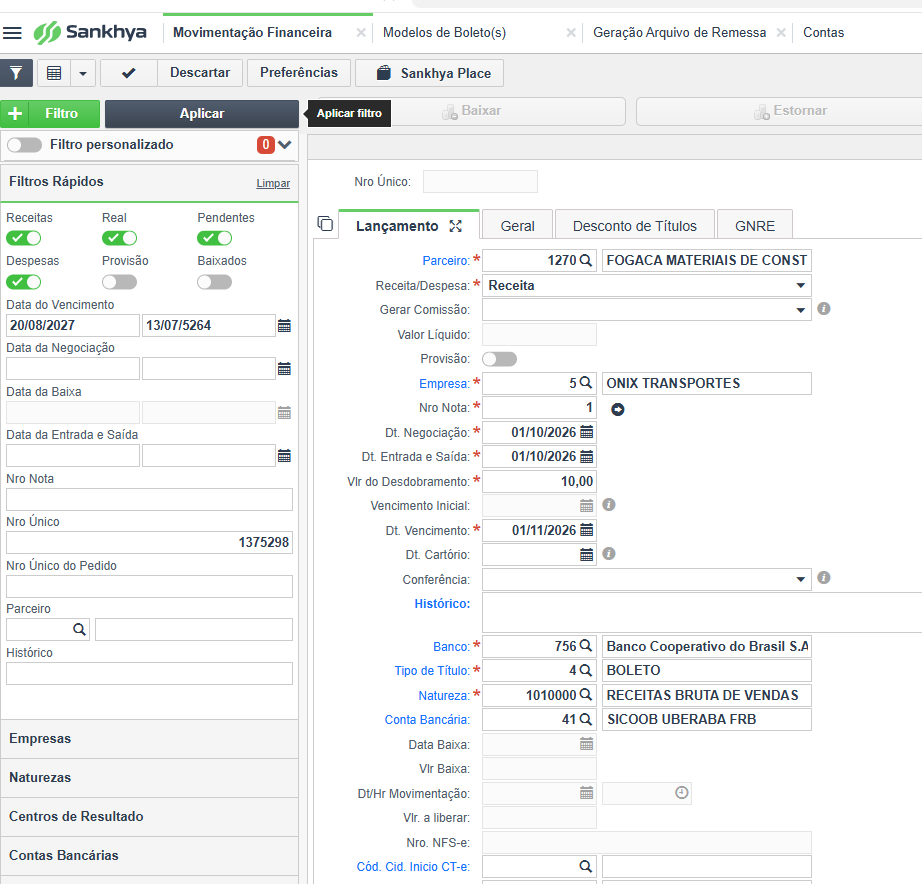
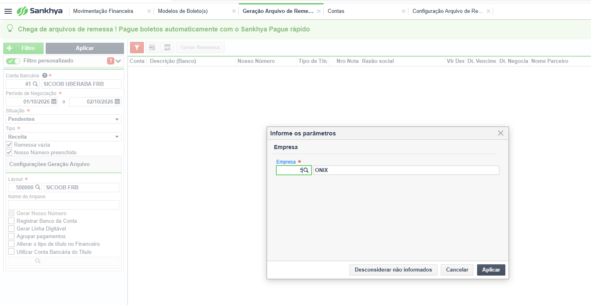
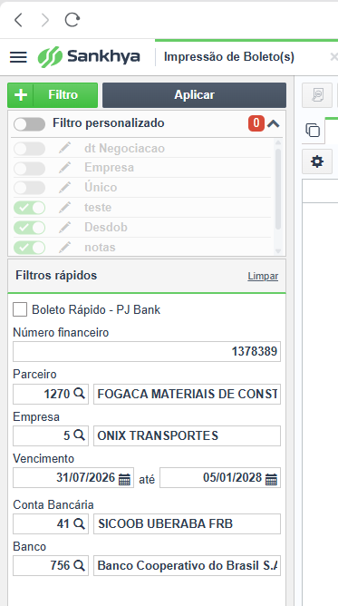

# Criação de um Lançamento Financeiro no 1270 Fogaça para Teste de Geração de Boleto

Este procedimento descreve o fluxo indicado no documento original para
preparar um lançamento financeiro de teste, utilizar a tela **Geração de
Arquivo de Remessa** e acessar a tela **Impressão de Boleto**.

> **Atenção:** realize o procedimento apenas com dados de teste
> autorizados. Antes de gerar arquivos de remessa ou boletos, confirme
> com o responsável pelo financeiro se a operação não enviará cobranças
> reais ao banco.

## Passo 1 --- Criar o lançamento financeiro de teste

Acesse a rotina de criação de lançamento financeiro utilizada pela
empresa e prepare o lançamento para o teste de geração do boleto.

1.  Preencha os campos necessários conforme o procedimento interno.
2.  Confira os dados do lançamento antes de salvar.
3.  Salve o lançamento e anote as informações necessárias para
    localizá-lo nas próximas etapas.

O documento original não mostra, em texto, os nomes de todos os campos
dessa tela. Siga o padrão adotado pela empresa e, se houver dúvida,
confirme os dados com o responsável pelo financeiro.

**Imagem 1 --- Criação do lançamento financeiro**



## Passo 2 --- Gerar a movimentação pela tela Geração de Arquivo de Remessa

Depois de preparar o lançamento, volte à tela **Geração de Arquivo de
Remessa**.

1.  Selecione o banco correspondente ao teste.
2.  Informe o período referente à dívida do teste.
3.  Clique em **Aplicar**.
4.  Na sequência indicada pelo procedimento original, selecione a
    **empresa 5** e clique em **Aplicar** novamente.
5.  Confira os dados apresentados e siga a ação de geração disponível na
    tela para gerar a movimentação financeira.

**Importante:** o documento menciona "1270 Fogaça" no título e "empresa
5" nesta etapa, mas não esclarece se esses identificadores correspondem
ao mesmo cadastro. Confirme essa relação no sistema ou com o responsável
antes de prosseguir. O nome do banco também deve ser confirmado na tela
do ambiente de teste.

**Imagem 2 --- Geração de Arquivo de Remessa, seleção do banco, período
e empresa**



## Passo 3 --- Acessar a tela Impressão de Boleto

Depois que a movimentação financeira for gerada:

1.  Acesse a tela **Impressão de Boleto**.
2.  Localize o lançamento gerado usando os filtros disponíveis e os
    dados anotados no primeiro passo.
3.  Confira os dados do título antes de imprimir ou gerar o boleto.
4.  Execute a impressão conforme a finalidade do teste e as permissões
    do ambiente.

**Imagem 3 --- Impressão de Boleto**



## Checklist de conferência

-   [ ] Preparei o lançamento financeiro de teste.
-   [ ] Voltei à tela **Geração de Arquivo de Remessa**.
-   [ ] Selecionei o banco correspondente ao teste.
-   [ ] Informei o período da dívida do teste e cliquei em **Aplicar**.
-   [ ] Selecionei a **empresa 5** e cliquei em **Aplicar**.
-   [ ] Confirmei que a movimentação financeira foi gerada.
-   [ ] Acessei a tela **Impressão de Boleto**.
-   [ ] Conferi os dados antes de imprimir ou gerar o boleto.

## Se o lançamento não aparecer

-   Confira se o lançamento financeiro foi salvo.
-   Revise o banco e o período informados na tela de remessa.
-   Confirme se a empresa selecionada é a correta para o teste.
-   Se ocorrer uma mensagem de erro, registre o texto completo e
    consulte o responsável pelo sistema antes de repetir a operação.

## Organização dos arquivos

Mantenha o arquivo Markdown e a pasta `images` no mesmo diretório:

``` text
geracao-de-boleto/
├── criacao_lancamento_geracao_boleto.md
└── images/
    ├── 1.png
    ├── 2.png
    └── 3.png
```

Os caminhos das imagens neste documento são relativos. Para que apareçam
no VS Code ou no GitHub, os arquivos devem estar na pasta `images` e ter
exatamente os nomes `1.png`, `2.png` e `3.png`.
